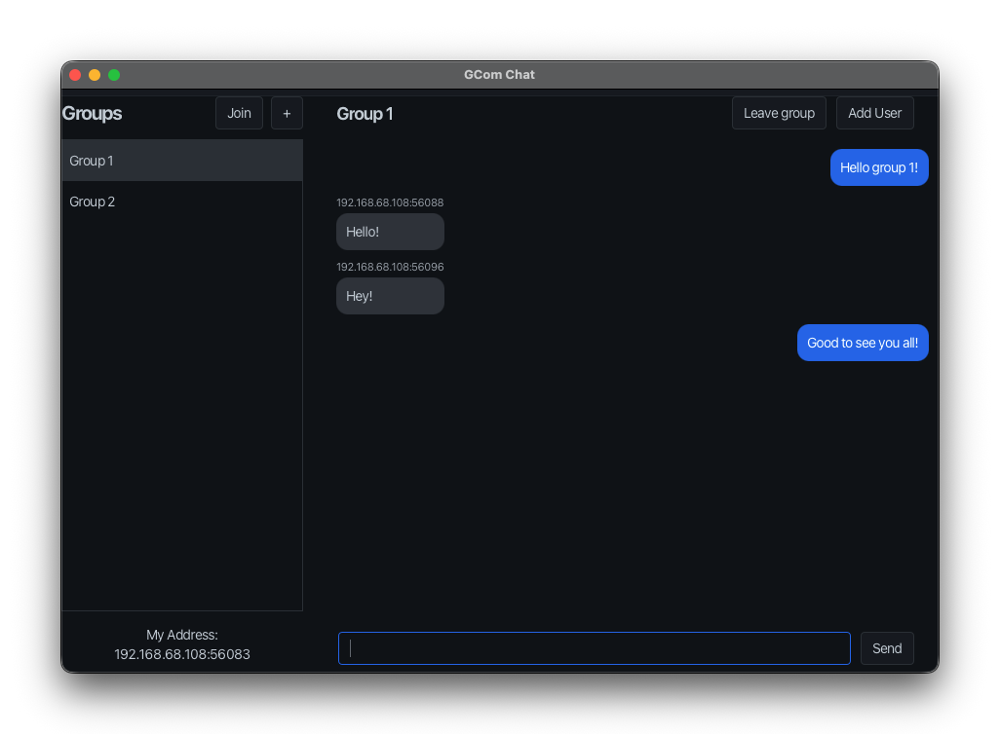
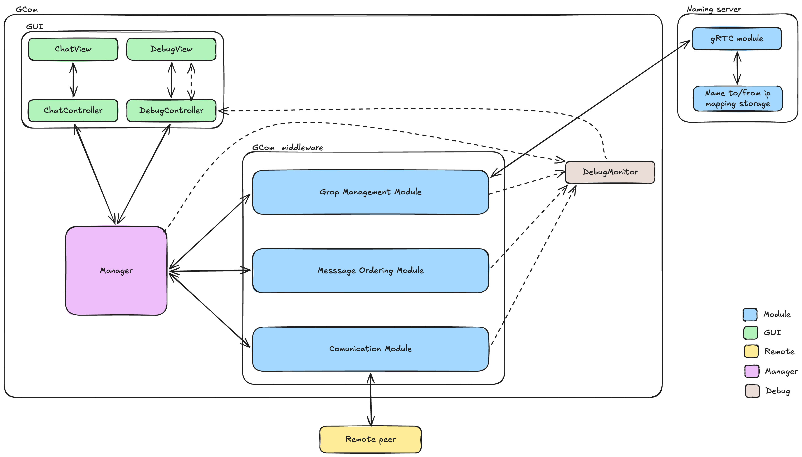
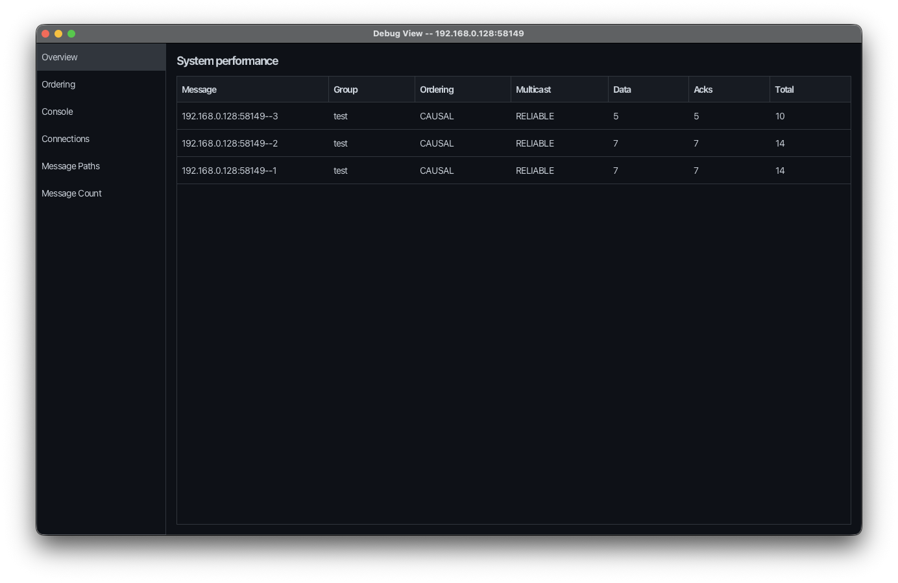
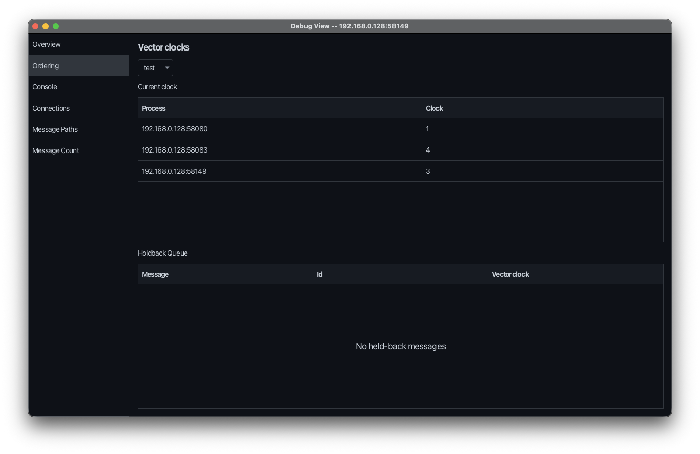
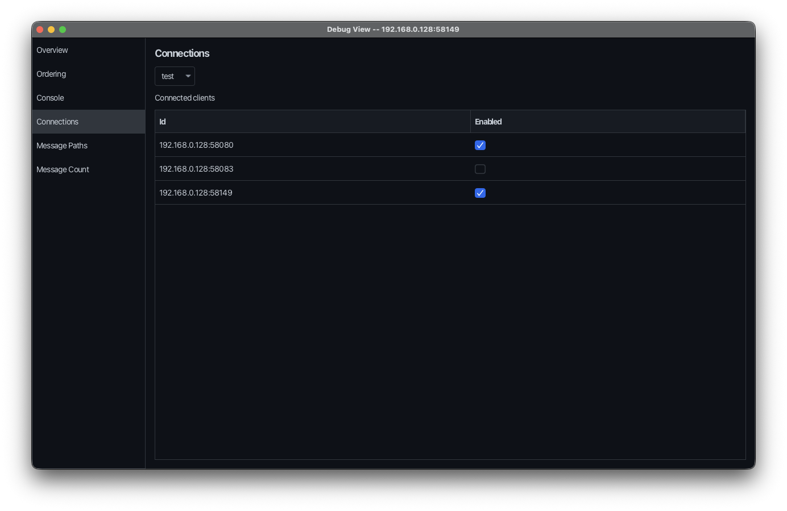
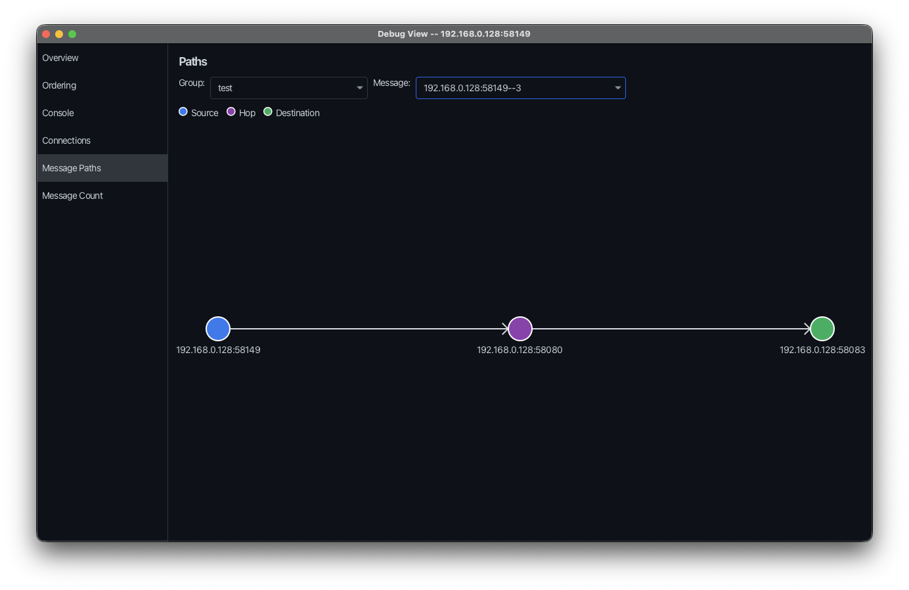
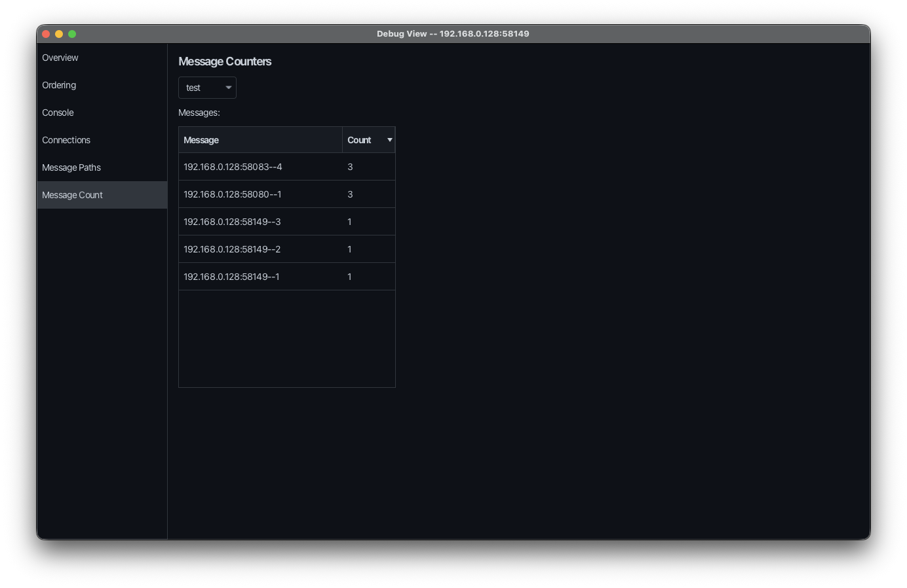

# GCom

GCom is a Java group communication framework and chat application built using gRPC, Protocol Buffers, and JavaFX (AtlantaFX theme). It supports peer-to-peer multicast messaging, causal ordering via vector clocks, dynamic and static group membership, and fault detection.



## Table of Contents
- [Features](#features)
- [Architecture](#architecture)
- [Prerequisites](#prerequisites)
- [Quick Start](#quick-start)
- [Usage](#usage)
- [Debugging & Telemetry](#debugging--telemetry)
- [Protobuf Definitions](#protobuf-definitions)
- [Authors](#authors)

## Features

- **Group Management**: Supports dynamic groups (open join/leave) and static groups (pre-configured member list required before sending).
- **Naming Server & Peer Fallback**: Centralized Naming Server for group discovery, with automatic peer-to-peer IP bootstrap if the Naming Server is offline.
- **Message Ordering**:
  - **Unordered**: Direct message delivery without ordering constraints.
  - **Causal**: Vector clock tracking (`VectorClock`) with a holdback queue to guarantee causally ordered delivery across nodes.
- **Reliability & Fault Detection**: Configurable reliable/unreliable multicast delivery with automated detection of node crashes via gRPC transport failures.
- **Built-in Visual Debugger**: In-app inspection suite built with SmartGraph to monitor vector clocks, message delivery paths, connection rosters, latency injection, and performance counters.

## Architecture

Below is the design overview showing the relationship between the JavaFX GUI, the core manager, the middleware modules, the central Naming Server, and remote peers.



## Prerequisites

- **Java**: JDK 21+ (built with JDK 25)
- **Maven**: 3.9+

## Quick Start

### 1. Build the project

Compile Protobuf schemas and Java classes:

```bash
mvn clean compile
```

### 2. Start the Naming Server (Optional)

Start the centralized Naming Server on port `1111`:

```bash
mvn exec:java
```

*If the Naming Server is not running, clients can still join groups by pointing directly to an existing peer's IP address.*

### 3. Launch a Chat Client

Run the JavaFX application:

```bash
mvn javafx:run
```

To test multi-node communication locally, open multiple terminal windows and run `mvn javafx:run` in each. Each client instance automatically binds to an available local port.

## Usage

### Creating a Group
1. Click **+** in the sidebar.
2. Enter a group name.
3. Choose your ordering model (`Causal` or `Unordered`) and multicast type (`Reliable` or `Non-Reliable`).
4. Select `Dynamic` for open groups or `Static` to require specific peer IPs before messaging begins.

### Joining a Group
1. Click **Join** in the sidebar.
2. Enter the target group name.
3. Provide a peer IP if the Naming Server is unavailable.

## Debugging & Telemetry

Open the debug window from the menu bar (**Debug** -> **Open Debug Window**) or press `Cmd+Shift+D` / `Ctrl+Shift+D`.

| Tab | Description | Screenshot |
| --- | --- | --- |
| **Overview** | Performance telemetry tracking data packets, ACKs, and multicast totals. |  |
| **Ordering** | Live vector clock state and holdback queue inspection per group. |  |
| **Connections** | Group roster manager and network delay injection controls. |  |
| **Message Paths** | SmartGraph visualization of multi-hop message routes. |  |
| **Message Count** | Delivery counters for tracking message duplicate IDs. |  |

## Protobuf Definitions

- `src/main/proto/communication.proto`: Defines peer communication RPCs, vector clocks (`map<string, int32>`), hop path tracking (`repeated string path`), and payload variants (`ChatMessage`, `GroupMembership`, `DataAck`).
- `src/main/proto/NamingServer.proto`: Defines registration, group lookup, and health check RPCs for the central Naming Server.

## Authors
- [Jonatan Westling](https://github.com/jonatanwestling)
- [Algot Granér](https://github.com/algotgraner)
- [Joakim Wiksten](https://github.com/jokwik02)
